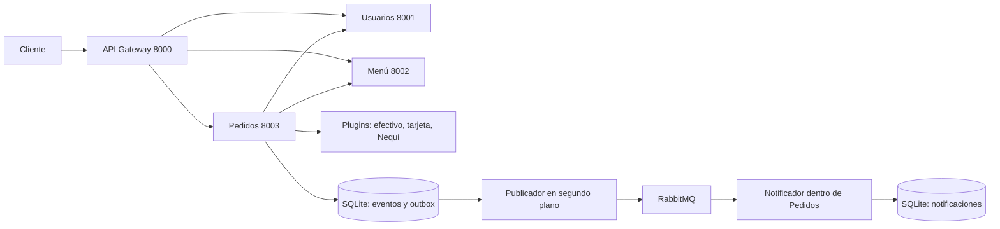

# FastBite Unificado

Integración de `fastbite-v2/fastbite-v2` y `fastbite-v4/fastbite-v4`.
La v2 aporta usuarios, menú, pedidos, plugins de pago y notificaciones AMQP.
La v4 aporta el diseño del API Gateway y CQRS/Event Sourcing. Se completan
los componentes incompletos y se entrega un Compose independiente de las carpetas originales.

Es una API académica con Swagger, sin interfaz de restaurante o tienda.
Los pagos son simulados; las notificaciones son avisos guardados y consultables,
sin envío de correos, SMS ni cobros a Nequi o tarjetas.

## Arrancar en PowerShell

Desde esta carpeta, con Docker Desktop en ejecución:

```powershell
.\iniciar-fastbite.ps1
```

También se puede ejecutar directamente:

```powershell
docker compose up -d --build --wait --wait-timeout 180
docker compose ps
```

Docker instala las dependencias dentro de una imagen Python 3.12 compartida por
los cuatro servicios HTTP. No necesita Python local. Se ejecuta como usuario sin privilegios.
El nombre de proyecto Compose es `fastbite-unificado`; los volúmenes quedan separados de otras demos.

| Componente | Dirección local | Función |
| --- | --- | --- |
| API Gateway | http://localhost:8000/docs | Entrada `/api/...`, proxy genérico |
| Usuarios | http://localhost:8001/docs | Cinco usuarios originales |
| Menú | http://localhost:8002/docs | Cinco productos originales |
| Pedidos | http://localhost:8003/docs | Swagger con esquemas de pedidos y notificaciones |
| RabbitMQ | http://localhost:15672 | Usuario `fastbite`, contraseña local `fastbite_local` |

El Swagger del Gateway describe rutas genéricas. Para editar un pedido con
formulario y esquema completos, usar el Swagger de Pedidos o los comandos siguientes.
Los puertos están publicados solamente en `127.0.0.1`.

## Demostración paso a paso

Consultar datos, crear un pedido y cambiar su estado pasando por el Gateway:

```powershell
Invoke-RestMethod 'http://localhost:8000/api/usuarios'
Invoke-RestMethod 'http://localhost:8000/api/menu'
$cuerpo = @{
    usuario_id = 1
    items = @(@{ producto_id = 3; cantidad = 2 })
    metodo_pago = 'nequi'
} | ConvertTo-Json -Depth 5
$respuesta = Invoke-RestMethod 'http://localhost:8000/api/pedidos' -Method Post -ContentType 'application/json' -Body $cuerpo
$idPedido = $respuesta.pedido.id
Invoke-RestMethod "http://localhost:8000/api/pedidos/$idPedido" -Method Put -ContentType 'application/json' -Body '{"estado":"enviado"}'
Invoke-RestMethod 'http://localhost:8000/api/pedidos/resumen'
Invoke-RestMethod 'http://localhost:8000/api/pedidos/eventos'
Invoke-RestMethod 'http://localhost:8000/api/notificaciones/salud'
Invoke-RestMethod 'http://localhost:8000/api/notificaciones/usuario/1'
```

Los avisos llegan de forma asíncrona; pueden tardar unos segundos en aparecer.
Las rutas de v4 también se aceptan: `/api/usuarios/usuarios/1`, por ejemplo.
Se conservan los endpoints directos originales de los tres servicios.

Para cargar los cinco escenarios de ejemplo de v2 en una base vacía:

```powershell
Invoke-RestMethod 'http://localhost:8000/api/pedidos/ejemplos' -Method Post
```

La carga es explícita, persistente y no duplica ejemplos si ya existen pedidos.
La validación automatizada deja sus propios pedidos de demostración; en ese caso
este endpoint informará que ya hay pedidos. No se borra información al arrancar.

## Operación

```powershell
.\fastbite.ps1 status
.\fastbite.ps1 logs orders
.\fastbite.ps1 reload orders
.\fastbite.ps1 down
.\fastbite.ps1 up
```

`down` detiene y retira los contenedores de este Compose, conservando volúmenes.
`down orders` solo detiene Pedidos. `notifier` es un alias de Pedidos.
El consumidor se conserva como módulo e hilo dentro de ese proceso, igual que en v2;
no hay un quinto microservicio HTTP ni un puerto 8004.
Para reconstruir cambios de código: `docker compose up -d --build --wait`.
No usar eliminación de volúmenes si se quieren conservar pedidos, eventos y avisos.

Las variables y puertos opcionales están en `.env.example`; copiarlo como `.env`
antes del primer arranque. Las URLs internas usan DNS de Compose, no `localhost`.
Cambiar la contraseña de RabbitMQ en un volumen ya inicializado requiere actualizar
también el usuario existente en el broker; las variables de inicialización solo aplican a datos nuevos.
Los valores AMQP personalizados deben ser seguros para una URL.

## Entorno local y pruebas

Se creó `.venv` nuevo para este checkout; no se reutilizó el entorno de v2.
Para recrearlo con Python 3.12:

```powershell
python -m venv .venv
.\.venv\Scripts\python.exe -m pip install -r requirements.txt
.\.venv\Scripts\python.exe -m pip check
.\.venv\Scripts\python.exe -m unittest discover -s tests -v
```

No hace falta activar el entorno. `requirements.txt` fija las versiones comprobadas;
`requirements.in` enumera las cuatro dependencias directas.

La misma suite funciona en Linux dentro del contenedor:

```powershell
.\fastbite.ps1 test
```

Prueba del sistema real (crea pedidos de demo, detiene su broker brevemente,
recrea Pedidos y verifica recuperación; no elimina volúmenes):

```powershell
.\.venv\Scripts\python.exe tests\validar_docker.py
```

Esta prueba usa los puertos por defecto y guarda `docs/validacion-docker.json`.
Los logs locales y Docker están en `docs/pruebas-locales.txt` y `docs/pruebas-docker.txt`.
Ver `docs/DIAGNOSTICO.md` para alcance, hallazgos y límites.

## Arquitectura integrada



Los comandos validan y agregan un evento con el snapshot del pedido. El evento y
su mensaje pendiente se guardan en una transacción SQLite. Las consultas reconstruyen
el último estado mediante replay. El publicador borra el pendiente cuando el broker
confirma; el notificador confirma tras persistir y deduplica por `evento_id`.
La entrega es al menos una vez, con deduplicación del efecto en el consumidor.
El resumen utiliza IDs reales y estados logísticos (`creado`, `enviado`, `en camino`,
`entregado`, `cancelado`); `aprobado` se acepta como alias histórico de `enviado` al actualizar.
